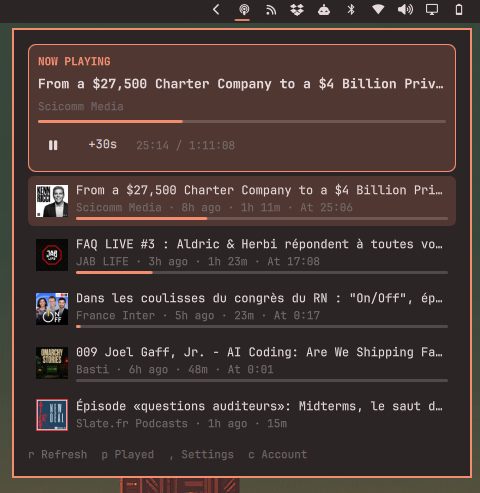

# Apple Podcasts — Omarchy bar widget

A bar icon that opens a panel with your latest Apple Podcasts episodes and plays them.



> **Unofficial.** Apple has no public API for your library, so this uses the same private
> endpoints as podcasts.apple.com. It can break whenever Apple changes the site and may
> sit outside Apple's terms. Personal use only.

## Requirements

`mpv` and `socat` (for playback), plus `curl`.

## Install

```sh
ln -s "$PWD" ~/.config/omarchy/plugins/omarchy-apple-podcasts
omarchy plugin enable anavarre.apple-podcasts
omarchy-shell shell rescanPlugins
omarchy bar move anavarre.apple-podcasts --section right
```

## Sign in

Apple offers no sign-in for third parties, so the widget borrows your web-player session:

1. Open the panel and press **Open podcasts.apple.com**.
2. Sign in with your Apple Account (2FA happens in the browser).
3. Copy the `media-user-token` cookie value (browser dev tools → Storage/Application → Cookies).
4. Paste it into the panel.

The token is stored privately on your computer in `~/.config/omarchy/apple-podcasts/` and is only sent to Apple.

## Using it

Click an episode to open the player.

| Key | Action |
| --- | --- |
| `Space` | Play / pause |
| `←` / `→` | Skip back / forward |
| `o` | Open the episode on Apple's site |
| `s` | Stop |
| `Esc` | Back to the list |
| `p` | Switch between unplayed and played episodes |
| `,` | Settings |

- **Resume anywhere.** Your position syncs with Apple, so you can switch between your iPhone and this computer.
- **Started episodes come first**, most recently listened to on top. The rest is grouped by show, or sorted by date if you prefer.
- **Subscriber-only episodes** can't be played here; the panel says so.

## Settings

Open them from the panel (`,`) or from Omarchy's bar settings:

- Episodes to show (1–50)
- Refresh interval
- Latest episodes or your Up Next queue
- Started episodes first, and how the rest is ordered (by show or by date)
- Skip back / forward length (10–90 seconds)
- Playback speed

## Uninstall

```sh
omarchy plugin disable anavarre.apple-podcasts
rm ~/.config/omarchy/plugins/omarchy-apple-podcasts
rm -r ~/.config/omarchy/apple-podcasts
omarchy-shell shell rescanPlugins
```

The last `rm` deletes your saved sign-in token and local listening positions. You can also remove the widget from the bar in Omarchy's bar settings. Your listening history on Apple is untouched.

## License

MIT
